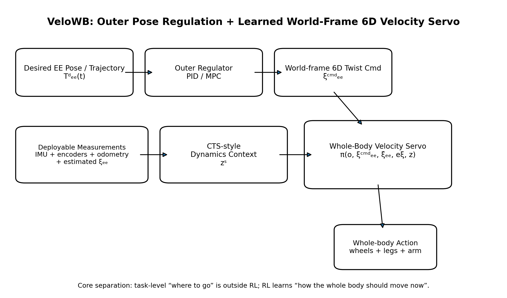
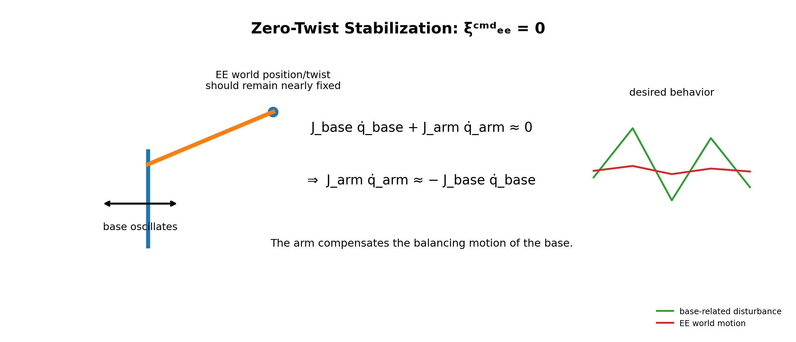
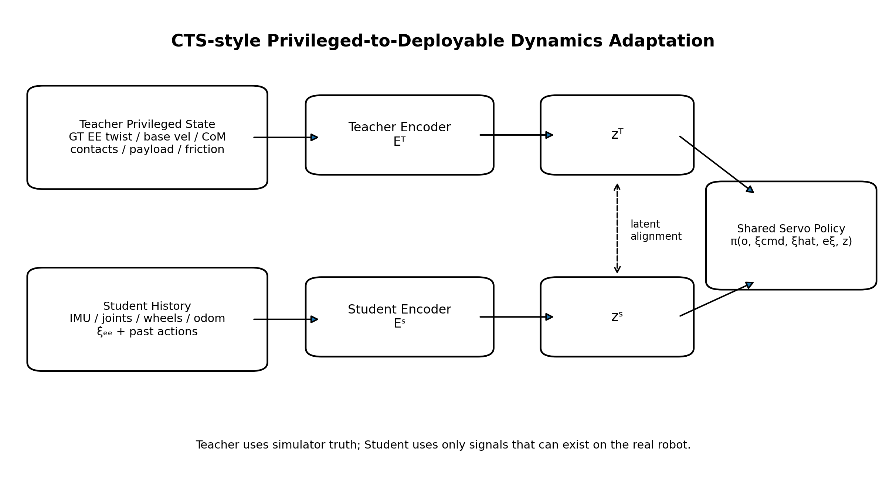
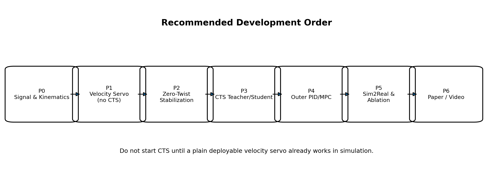

版本：v1.3 · 2026-10-03

研究主线：外层位姿调节器 + 世界系 6D EE velocity servo + whole-body balancing + CTS-style dynamics adaptation

| **一句话目标：**不让 RL 直接“记住一个目标位姿”。RL 只学习一个可复用的世界坐标系 6D 末端速度伺服器：给定 EE twist command，它用轮、腿、机械臂的全身自由度平滑追踪该速度并维持双轮足动态平衡；当 command=0 时，机械臂自动补偿 base 摇晃，使 EE 在世界系近似静止。 |
|-----------------------------------------------------------------------------------------------------------------------------------------------------------------------------------------------------------------------------------------------------------------|

# 文档目录

1\. 研究想法最终定义

2\. 研究动机：为什么位置追踪可能不是双轮足操作的最佳内层任务

3\. 与现有工作的关系与论文边界

4\. 控制架构：Outer Pose Regulator + Learned Velocity Servo

5\. 任务空间与 6D Twist 定义

6\. Zero-Twist Stabilization：本项目最关键的可视化行为

7\. Whole-Body Policy：Observation / Command / Action

## 7.4 解析运动学前瞻：预测未来机械臂状态

在本项目中，IK 不仅可以输出当前时刻的几何运动先验，还可以进一步向前滚动，形成一个短时域的 future kinematic preview。其目的不是预测真实动力学，而是提前告诉策略：如果按照当前 EE twist command 与 IK 解继续运动，机械臂未来会处于什么构型、末端会往哪里运动、Jacobian 如何变化，以及机械臂质心将如何迁移。

对当前机械臂关节状态 q_t^arm 和速度先验 qdot_t^IK，可在离散时域内进行解析积分：qhat\_{t+k+1}^arm = qhat\_{t+k}^arm + qdot\_{t+k}^IK Δt。随后通过 FK 与 Jacobian 得到未来末端状态：That\_{ee,t+k}=FK(qhat\_{t+k}^arm)，xihat\_{ee,t+k}=J(qhat\_{t+k}^arm) qdot\_{t+k}^IK。

如果 URDF 中包含可靠的 link mass / COM 参数，还可以由各 link 的预测位姿计算未来机械臂质心：phat_COM^arm = (Σ_i m_i phat_i)/(Σ_i m_i)。这类量属于“未来几何构型信息”，与真实接触力、惯性反作用力、执行器滞后等动力学量必须严格区分。

建议形成一个短时域运动学特征窗口 z_t^kin，例如包含 {qhat_arm, That_ee, xihat_ee, phat_COM^arm, Jhat}\_{t:t+H}。第一版不需要使用 Transformer，可直接对若干离散 preview 点拼接后送入小型 MLP，或者直接把低维解析特征作为 policy observation。

推荐的最终分工是：IK / kinematic rollout 负责提供“几何上下一步与未来可能发生什么”；CTS history latent z_t^dyn 负责估计 payload、接触、轮地相互作用、base oscillation phase、执行器滞后等“运动学模型解释不了的动力学上下文”；RL policy 最终完成动态平衡、whole-body redundancy allocation 与 residual correction。

因此整体结构可以写为：ξ_ee^cmd → velocity IK → future kinematic rollout → z^kin；同时 observation history → CTS Student → z^dyn；最终 a_t = π(o_t, ξ_ee^cmd, e_ξ, z_t^kin, z_t^dyn)。

重要边界：运动学前瞻不能被表述为 reaction wrench predictor。若后续需要显式预测机械臂加速度对 base 的反作用，则需要 rigid-body dynamics / learned residual dynamics；在当前版本中，运动学前瞻仅作为 physics-informed feedforward prior。

8\. CTS-style Teacher–Student Dynamics Adaptation

9\. Teacher 与 Student 的信息边界

10\. EE World Twist 的真机在线估计

11\. Reward 与“好用的 Servo”训练目标

12\. Command Curriculum 与 Servo 频率特性训练

13\. Outer PID / MPC 设计

14\. Baseline 与论文必须回答的问题

15\. 实验设计：从控制指标到真机任务

16\. Ablation 设计

## 16.1 运动学前瞻消融

必须区分“IK 当前动作先验”和“未来运动学前瞻”的收益。建议至少比较：① 无 IK / 无 preview；② current IK prior only；③ IK + future joint rollout；④ IK + future joint/EE rollout；⑤ IK + future COM/Jacobian preview；⑥ 完整 preview + CTS dynamics latent。

重点指标不是只看最终成功率，还要比较 zero-twist stabilization、velocity RMSE、overshoot、settling time、jerk、base→EE disturbance transmission ratio，以及 OOD payload 下的退化速度。若 future preview 相比 current IK prior 没有稳定增益，则不把它作为主方法组成。

17\. Sim2Real 与噪声/时延建模

18\. 论文贡献的安全表述

19\. 你需要完成的完整步骤

20\. 12 周执行计划

21\. 每阶段 Go / No-Go 标准

22\. 代码仓库与数据记录规范

23\. Figure / Table / Video 规划

24\. 投稿前必须完成的最小证据闭环

25\. RSS 水平判断、论文叙事与必须完成的证据

## 25.8 运动学前瞻在 RSS 叙事中的位置

不要把“用 FK 预测未来机械臂状态”单独包装成主创新。更稳妥的叙事是：world-frame 6D velocity servo 是问题 formulation；future kinematic preview 是 physics-informed feedforward prior；CTS latent 是 deployment-oriented dynamics adaptation。只有当实验表明 future preview 显著改善双轮足动态平衡下的 EE servo 性能时，它才升级为方法贡献。

最理想的论文证据是：在相同 servo policy 与相同 CTS 设置下，future kinematic preview 能提前响应 arm configuration / COM migration，在 base 明显发生姿态变化之前降低 EE twist error 或 disturbance transmission。

26\. 参考文献与必读工作

# 1. 研究想法最终定义

当前项目不再以“未来机械臂扰动预测”为主线，而是围绕一个更基础、更可复用的控制接口展开：

**训练一个世界坐标系下的 6D End-Effector Velocity Servo，使双轮足移动操作机器人在动态平衡过程中，用 wheels + legs + arm 的全身自由度平滑、低超调地跟踪末端 twist command。**

RL 内层完全看不到目标位姿 Tᵈₑₑ，也不看 pose error。任务层“要到哪里”由外层 PID/MPC 完成；RL 只回答“为了得到当前要求的世界系末端速度，全身现在应该怎么动”。

Tᵈₑₑ(t) → Outer PID / MPC → ᵂξᶜᵐᵈₑₑ(t) → Learned Whole-Body Velocity Servo → u_whole-body

- 保底任务：静态目标位姿 reaching。

- 扩展任务：连续轨迹 tracking（line / circle / figure-eight / wiping-like trajectories）。

- 核心平台特性：双轮足 base 本身需要持续动态平衡，存在前后摇摆，因此 base 不是固定参考系。

- 核心策略行为：当 ξᶜᵐᵈ=0 时，允许 base 动，但 arm 必须自动反向补偿，从而使 EE 在世界坐标系近似静止。

- 角速度部分采用简化：EE yaw 主要由本体 yaw 提供，机械臂相应 yaw 自由度锁住或强约束；roll/pitch 仍可由 arm/whole body 协同。

# 2. 研究动机：为什么位置追踪可能不是双轮足操作的最佳内层任务

现有 whole-body loco-manipulation RL 工作大量直接训练 6D EE pose tracking。对于四足或较稳的浮动基座，这一 formulation 很自然；但双轮足平台为了维持平衡，本体会主动产生 pitch/translation motion。若 RL 同时承担“绝对目标位置调节”和“高速动态平衡”，两个不同时间尺度的目标被揉进同一个 policy。

e_pose(t) = Tᵈₑₑ ⊖ Tₑₑ(t)

base 的平衡摇摆会持续改变 Tₑₑ(t)，因此 pose error 同时混合了任务误差与平衡运动。你的想法是把慢变量与快变量分开：外层负责 pose regulation；内层只学习局部的 task-space velocity servo。

slow loop: pose error → desired twist

fast loop: desired twist → whole-body dynamic action

| **需要论文验证，而不是先验断言：**文档把“velocity-space formulation 对双轮足更合适”当作研究假设，不当作已证事实。论文必须通过 direct pose-tracking baseline 与 velocity-servo+outer-loop 的同任务对比来证明。 |
|---------------------------------------------------------------------------------------------------------------------------------------------------------------------------------------------------------------|

# 3. 与现有工作的关系与论文边界

目前最直接的相邻工作包括：直接 6D EE pose tracking 的轮式四足移动操作 RL、whole-body pose control、视觉 whole-body control，以及 CTS。它们意味着本文不能把“whole-body RL”“teacher-student”或“EE tracking”本身当作 novelty。

| **工作**                                                               | **与本项目最相关的点**                                                       | **我们不能重复的主张**                             | **本项目拟验证的区别**                                                                                                       |
|------------------------------------------------------------------------|------------------------------------------------------------------------------|----------------------------------------------------|------------------------------------------------------------------------------------------------------------------------------|
| Jiang et al., RA-L 2025：wheeled-quadrupedal 6D EE pose tracking \[1\] | 不约束 base command，RL 用冗余全身自由度直接追踪 6D EE pose；teacher-student | “RL 能做 6D EE tracking / whole-body coordination” | 将内层任务改成 world-frame 6D twist servo；外层 pose regulation；以 servo 动态指标和 zero-twist disturbance rejection 为核心 |
| Portela et al., ICRA 2025：Whole-Body EE Pose Tracking \[2\]           | legged whole-body pose tracking，大工作空间、rough terrain                   | “全身 RL 可以在大工作空间追踪 EE pose”             | 不直接追 pose；研究速度伺服接口与动态平衡耦合                                                                                |
| Fu et al., CoRL：Deep Whole-Body Control \[3\]                         | 统一 arm+legs RL，使用 EE command / base command                             | “统一 policy 控制 locomotion+manipulation”         | base 暂无 task command；EE velocity 是主要任务接口                                                                           |
| Liu et al., CoRL：Visual Whole-Body Control \[4\]                      | 低层 policy 追踪 body velocity + EE position                                 | “高低层 whole-body architecture”                   | 低层不追 EE position，改为 world-frame 6D EE twist servo                                                                     |
| Wang et al., RA-L 2024：CTS \[5\]                                      | teacher/student 并发训练；privileged encoder 与 history encoder              | “CTS 是我们的创新”                                 | CTS 仅作为 dynamics adaptation/training mechanism；主线仍是 velocity-servo formulation                                       |
| Zhi et al., CoRL 2025：Position+Force unified policy \[6\]             | 历史状态估计交互力并做全身调整                                               | “history 能估计动态信息”                           | Student latent 聚焦 balancing/manipulation dynamics；不做 force-control 主线                                                 |

| **最重要的撞题风险：**Jiang et al. 2025 已经非常接近“轮足/轮式腿式移动操作 + 不约束 base + 6D EE tracking”。因此你真正要证明的不是“我也能 whole-body tracking”，而是“velocity-space servo formulation 在双轮足动态平衡下带来更好的闭环品质、可复用性与扰动抑制”。 |
|-------------------------------------------------------------------------------------------------------------------------------------------------------------------------------------------------------------------------------------------------------------------|

# 4. 控制架构：Outer Pose Regulator + Learned Velocity Servo

## 4.1 内外环职责

| **层级**            | **输入**                            | **输出**              | **职责**                                |
|---------------------|-------------------------------------|-----------------------|-----------------------------------------|
| Outer loop          | Tᵈₑₑ(t), Tₑₑ(t)                     | ᵂξᶜᵐᵈₑₑ               | 决定“去哪”；处理静态位姿目标或连续轨迹  |
| Inner learned servo | robot state, ξcmd, ξhat, eξ, latent | wheel+leg+arm actions | 决定“现在全身怎么动”；速度跟踪+动态平衡 |
| Robot/estimator     | sensors, kinematics                 | Tₑₑ, ξ̂ₑₑ              | 提供部署时可用的世界系 EE 状态估计      |

RL 内层不得输入 Tᵈₑₑ 或 pose error。这样才能证明它是一个可复用的 velocity servo，而不是换皮的 pose tracker。

# 5. 任务空间与 6D Twist 定义

ᵂξₑₑ = \[ ᵂvₑₑᵀ , ᵂωₑₑᵀ \]ᵀ ∈ R⁶

ᵂξᶜᵐᵈₑₑ = \[vₓ, vᵧ, v_z, ωₓ, ωᵧ, ω_z\]ᵀ

线速度三轴均进入 command。角速度允许根据硬件形态做约束：机械臂的 yaw 关节锁定或限制，使 EE yaw angular velocity 主要由 base yaw 提供；这迫使策略真正使用全身冗余，而不是把所有角度任务都交给腕部。

- 训练早期可先只开放 3D linear + yaw，再逐步扩到 6D twist，降低优化难度。

- 最终论文若宣称 6D servo，需要至少对所有 6 个 command 维度给出 tracking 指标；若某一轴被结构性约束，应在 problem formulation 中明确。

# 6. Zero-Twist Stabilization：本项目最关键的可视化行为

ᵂξᶜᵐᵈₑₑ = 0

这不意味着“机器人全身静止”。双轮足 base 仍可为了平衡前后运动。策略需要通过 arm / wheel / leg 的协同，把 base 运动在 EE 上造成的速度抵消掉。

J_base(q) q̇\_base + J_arm(q) q̇\_arm ≈ 0

J_arm(q) q̇\_arm ≈ − J_base(q) q̇\_base

该行为不设置专门的“补偿规则奖励”。只要 velocity tracking reward 中包含大量 zero-command 样本，策略就应自然学出 disturbance rejection。如果必须额外手写补偿规则才能出现该行为，说明统一 servo formulation 的说服力下降。

# 7. Whole-Body Policy：Observation / Command / Action

## 7.1 Student deployable inputs

| **输入组**           | **建议变量**                                                        | **备注**                                         |
|----------------------|---------------------------------------------------------------------|--------------------------------------------------|
| Robot proprioception | IMU angular velocity, projected gravity, leg/arm q & q̇, wheel speed | 全部真机可得                                     |
| World state estimate | base odometry / estimated linear velocity                           | 来源需固定，避免训练/部署不一致                  |
| EE measurement       | ξ̂ₑₑ                                                                 | 由 odometry/IMU + encoder + FK/Jacobian 在线计算 |
| Servo command        | ξᶜᵐᵈₑₑ                                                              | 外层或测试命令发生器输出                         |
| Explicit error       | eξ = ξcmd − ξhat                                                    | 主 servo 误差信号                                |
| History              | past observations + previous actions                                | 供 Student dynamics encoder 使用                 |
| Context latent       | zˢ                                                                  | CTS-style student encoder 输出                   |

建议同时给 policy：ξcmd、ξhat 和 eξ。只给 error 会丢失工作点信息；只给 command 和 measurement 会让网络白白学习一个明确的减法。

## 7.2 Action

Policy 输出全身控制量，至少包括 wheel + legs + arm。具体 action space 需遵循现有稳定底层接口：

- 轮子：target velocity / target torque（二选一，首版优先现有可靠接口）。

- 腿：joint position residual 或 target position，底层 PD 执行。

- 机械臂：joint position/velocity residual 或 target velocity；首版优先与真实 PiperX 可部署接口一致。

- 不让另一个独立 arm controller 在 policy 后偷偷完成 EE tracking，否则 whole-body credit assignment 会被破坏。

## 7.3 IK / Resolved-Rate 作为运动先验

建议把 IK 放在“运动先验”而不是“最终控制器”的位置。它提供满足末端 twist 的几何方向，RL 负责在双轮足动态平衡、接触、载荷、执行器和 Sim2Real 约束下进行修正。这样可以减少纯 RL 从零探索 task-space 到 whole-body action 映射的负担，同时保留 whole-body redundancy 的学习空间。

ξₑₑ = J_wb(q) q̇\_wb

q̇\_IK = argmin_q̇ \|\|J_wb q̇ − ξₑₑ^cmd\|\|²_W + λ\|\|q̇\|\|² + R_null(q, q̇)

其中 J_wb 为包含 base / wheel-leg / arm 对 EE twist 贡献的 whole-body Jacobian。首版不要求 IK 处理完整动力学，只要求给出几何上合理、平滑、满足关节限制的 nominal motion。

推荐主结构：

a_t = a_t^IK + Δa_t^RL

RL policy 输入仍包含 robot state、ξcmd、ξhat、eξ 和 CTS latent，同时额外接收 aIK；policy 输出 residual Δa。为了防止 RL 完全推翻先验，初期可对 residual 做幅值限制，训练稳定后再逐步放宽。

IK 的三种使用方式都保留用于实验：① IK-only / IK+balance 作为经典 baseline；② IK action 作为 observation prior；③ IK + RL residual 作为推荐方法。最终是否把 residual 结构放进主方法，必须由公平消融决定，不能预先假设它一定优于 plain RL。

当 ξcmd=0 时，IK nominal action 接近零，但 RL residual 仍可根据 base 摇晃和 CTS 动态 latent 主动驱动机械臂反向补偿。因此 zero-twist stabilization 仍然是 learned dynamic behavior，而不是被 IK 手工写死。

# 8. CTS-style Teacher–Student Dynamics Adaptation

CTS 的价值不是让 Student“看得更少”，而是让训练阶段利用 simulator privileged state 学到控制相关的动态上下文，同时保持部署端只依赖真实可得信号。Teacher 与 Student 可以并发 rollout，共享 servo policy；privileged encoder 和 history encoder 输出 latent，并通过 alignment/reconstruction loss 连接。

zᵀ_t = Eᵀ(s_priv,t)

zˢ_t = Eˢ(o\_{t-H:t}^{real-like})

a_t = π(o_t, ξcmd_t, ξhat_t, eξ_t, z_t)

L_total = L_PPO^T + L_PPO^S + λ_rec \|\|zˢ_t − stopgrad(zᵀ_t)\|\|²

| **实现纪律：**先做“无 CTS 的 plain velocity servo”，确认 formulation 本身有效；然后再加入 CTS。否则训练失败时无法判断是 servo 定义有问题，还是 teacher-student 机制有问题。 |
|-----------------------------------------------------------------------------------------------------------------------------------------------------------------------------|

# 9. Teacher 与 Student 的信息边界

| **信息**                           | **Teacher**                  | **Student / 真机**        | **理由**                                 |
|------------------------------------|------------------------------|---------------------------|------------------------------------------|
| GT EE world twist                  | ✓ simulator rigid-body truth | ✓ 估计值 ξ̂，可带噪声/时延 | Teacher 使用真值；Student 使用可部署版本 |
| Base world linear/angular velocity | ✓ GT                         | ✓ odom/IMU estimate       | 可部署则不必故意隐藏                     |
| CoM position / velocity            | ✓                            | 通常 ×                    | 典型 privileged dynamics info            |
| Contact forces / wrenches          | ✓                            | 默认 ×                    | 若真机无力传感器则只给 Teacher           |
| Ground friction                    | ✓                            | ×                         | domain parameter                         |
| Payload mass / COM                 | ✓                            | ×                         | 测试 Student 隐式适应能力                |
| Motor strength / actuator params   | ✓                            | ×                         | Sim2Real latent source                   |
| Joint state / IMU / wheel speed    | ✓                            | ✓                         | 共享 deployable signals                  |
| Command history / actions          | ✓                            | ✓                         | Student system identification 的关键     |

# 10. EE World Twist 的真机在线估计

你已确定真机通过 joint encoder + forward kinematics/Jacobian + base odometry/IMU 在线计算世界系 EE twist。实现时要注意：仅用 arm Jacobian 不够，必须把 floating base 对 EE 的线速度与角速度贡献算进去。

ᵂV_E = Ad\_{ᵂT_B} · ( V_B + J_BE(q_arm) q̇\_arm )

更工程化地，可分成 base twist 和 arm relative twist 后再做坐标变换。需要重点处理：

- base angular velocity 对 EE 线速度的 ω × r 项；

- odometry 与 IMU 的时间戳同步；

- joint velocity 噪声与数值微分问题（优先驱动层 q̇；没有时再滤波估计）；

- 世界系 / body 系 / arm-base 系 frame convention 固定；

- orientation angular velocity 的坐标系一致性；

- 延迟：ξ̂ 必须带 timestamp，并在训练中随机化相似延迟。

| **第一项工程任务：**在不训练任何 RL 之前，单独实现并验证 ξ̂ₑₑ estimator。用仿真 GT twist 对比估计 twist；如果这个误差很大，后续 servo 一定会被污染。 |
|-----------------------------------------------------------------------------------------------------------------------------------------------------|

# 11. Reward 与“好用的 Servo”训练目标

目标不是最高带宽，而是平滑、稳定、低超调。因此 reward 不能只看 instant velocity error。建议第一版总 reward：

r = w_t r_twist + w_b r_balance + w_s r_smooth + w_e r_energy + w_j r_joint + w_c r_contact

## 11.1 核心 twist tracking

eξ = ξcmd − ξhat

r_twist = exp( − eξᵀ Wξ eξ )

线速度与角速度量纲不同，必须分别归一化/加权。

## 11.2 Balance

- projected gravity / roll-pitch penalty；

- base angular velocity penalty；

- 必要时加 base height / leg posture regularization；

- 不要把 base position 或 base velocity tracking 当主任务，因为目前 base 是自由冗余。

## 11.3 Smoothness / low overshoot

r_Δa = − \|\|a_t − a\_{t−1}\|\|²

r_jerk ≈ − \|\|a_t − 2a\_{t−1} + a\_{t−2}\|\|²

可以先用 action-rate penalty；只有当出现明显 jerk 时再加二阶项，避免 reward 过多。

## 11.4 Zero command 不加专门 reward

zero-twist 稳定能力来自同一个 r_twist。训练 command distribution 中必须显式安排一定比例的 ξcmd=0 或接近 0 的 dwell segment，但不额外定义“EE 钉住世界”的独立规则。

# 12. Command Curriculum 与 Servo 频率特性训练

如果要得到真正“好用的 velocity servo”，command 不应只是每几秒随机跳一个常数。建议把训练输入当作系统辨识中的 excitation signals 设计。

| **Command 类型**                       | **用途**                                             | **训练阶段**   |
|----------------------------------------|------------------------------------------------------|----------------|
| Zero / near-zero dwell                 | 学习 disturbance rejection / EE stabilization        | 从第一天就加入 |
| Piecewise constant                     | 基础 steady-state tracking                           | 早期           |
| Ramp / trapezoid                       | 低超调速度切换                                       | 早期           |
| Low-frequency sine                     | 跟踪动态与相位滞后                                   | 中期           |
| Band-limited random signal             | 覆盖连续频谱，避免记模式                             | 中期           |
| Spline / minimum-jerk velocity profile | 接近真实外层输出                                     | 中后期         |
| Step                                   | 主要用于测试 rise/settling/overshoot，不必高比例训练 | 测试为主       |

建议逐步扩频，不追求极高频。你的目标是“平滑、稳定、低超调”，因此最终需要画频率响应近似图或至少不同 command frequency 下的 gain / phase / RMSE。

# 13. Outer PID / MPC 设计

## 13.1 保底：SE(3) P/PD/PID regulator

e_p = pᵈ − p

e_R = Log( Rᵀ Rᵈ )

ξcmd = K_p \[e_p, e_R\] + K_d \[ė_p, ė_R\] + ξ_ff

静态目标 ξ_ff=0；连续轨迹可加入 desired feedforward twist。所有 command 需要 saturation、rate limit 和低通，使其落在 inner servo 的已训练 command envelope 内。

## 13.2 后续：MPC

MPC 的价值是显式考虑速度/工作空间/碰撞/command rate constraints，但不要把 MPC 放进第一版研究主线。先证明 inner servo + 简单 PD 能完成静态 reaching 和连续轨迹，再决定是否需要 MPC。

# 14. Baseline 与论文必须回答的问题

| **Baseline**                        | **定义**                                                         | **它回答的问题**                                                                |
|-------------------------------------|------------------------------------------------------------------|---------------------------------------------------------------------------------|
| B0 Direct Pose RL                   | 直接输入 Tdes / pose error，whole-body policy 追 6D EE pose      | 你改成 velocity-space formulation 到底有没有必要？                              |
| B1 Velocity Servo, no history/CTS   | 当前 robot state + ξcmd/ξhat/eξ                                  | servo formulation 本身能否工作？                                                |
| B2 Velocity Servo + history encoder | 只用 deployable history，不做 Teacher                            | 历史动态信息是否有帮助？                                                        |
| B3 Two-stage Teacher→Student        | 传统先 Teacher 后 distill Student                                | Concurrent CTS 是否必要？                                                       |
| B4 CTS-style Velocity Servo         | 完整方法                                                         | 主方法                                                                          |
| B5 IK / Resolved-Rate Baseline      | 仅使用 velocity IK/QP（可配已有平衡器），不使用 learned residual | 几何 task-space controller 在双轮足动态平衡下能做到什么程度？                   |
| B6 Plain RL + IK as Observation     | 将 aIK 作为 policy 输入，但 policy 直接输出完整 action           | IK 作为信息先验是否已经足够，而不需要 residual 结构？                           |
| B7 IK + RL Residual (+CTS)          | a = aIK + ΔaRL；可与 history/CTS 组合                            | kinematic prior + learned dynamic correction 是否提升样本效率、平滑性和鲁棒性？ |

最关键的对比是 B0 vs B1/B4：相同的最终静态 target / continuous trajectory 任务，比较最终 pose error、overshoot、settling time、EE disturbance rejection 以及 whole-body smoothness。否则“velocity servo 更适合双轮足”的主张无法成立。

# 15. 实验设计：从控制指标到真机任务

## 15.1 Servo-level metrics

| **指标**                    | **定义 / 说明**                                        |
|-----------------------------|--------------------------------------------------------|
| Steady-state velocity error | command 稳定后 \|\|ξcmd−ξ\|\|                          |
| Rise time                   | step command 从 10%→90% 的时间                         |
| Settling time               | 进入并保持 ±2% / 自定义容差带                          |
| Overshoot                   | 速度响应峰值相对 command 的超调                        |
| Tracking RMSE               | 连续 command 下 6D weighted RMSE                       |
| Smoothness                  | action rate / joint jerk / EE acceleration             |
| Disturbance rejection       | ξcmd=0 时 base 摇晃或外扰下 EE world drift / twist RMS |
| Balance                     | pitch/roll RMS、peak angle、fall rate                  |
| Energy                      | Σ\|τ_i q̇\_i\| 或平台可得 proxy                         |

## 15.2 必做实验 A：Zero-Twist

1.  设置 ξcmd=0，机器人原地动态平衡。

2.  记录 base pitch/translation 与 EE world pose/twist。

3.  比较 B0/B1/B2/B4。

4.  人为给 base/robot 小扰动或改变 payload，观察 EE 是否仍保持近似静止。

5.  视频必须同时显示“base 在晃、EE 近似钉住”。

## 15.3 必做实验 B：6D velocity primitives

分别给单轴 command，先 isolate 再组合：±vx、±vy、±vz、±ωx、±ωy、±ωz。记录 step/ramp/sine response。

## 15.4 必做实验 C：Outer-loop static reaching

给多个 EE static goals，外层 PD 输出 twist。比较 Direct Pose RL 与 Velocity Servo 的最终误差、超调、settling time，以及 base/arm smoothness。

## 15.5 扩展实验 D：Continuous trajectory

- straight line

- circle

- figure-eight

- 3D spline

- orientation-only trajectory

该实验用于证明同一个 velocity servo 不需要重新训练即可服务不同任务轨迹。

## 15.6 Robustness

- 不同 payload / arm COM

- 不同 ground friction

- sensor noise

- command / actuation latency

- 模型参数误差

- 外部推扰

- 轻度坡地（后期）

# 16. Ablation 设计

| **Ablation**              | **比较项**                                       | **要回答的问题**                                               |
|---------------------------|--------------------------------------------------|----------------------------------------------------------------|
| A1 Servo input            | error only vs cmd+meas vs cmd+meas+error         | 显式 servo error 是否有价值                                    |
| A2 History length         | 0 / 0.1 / 0.2 / 0.4 / 0.6 s                      | 双轮足 oscillation / dynamics 需要多长历史                     |
| A3 Teacher privileged set | 全部 vs 去掉 payload vs 去掉 contact vs 去掉 CoM | 哪些 privileged signals 真正有控制价值                         |
| A4 CTS                    | no teacher vs two-stage vs concurrent            | CTS 是否真的提升 deployable servo                              |
| A5 command distribution   | piecewise constant vs band-limited curriculum    | “好用 servo”是否来自更合理 excitation                          |
| A6 zero-command ratio     | 0 / 10 / 30 / 50%                                | disturbance rejection 如何形成                                 |
| A7 yaw constraint         | arm yaw free vs locked/limited                   | whole-body redundancy allocation 是否真正发生                  |
| A8 action smoothness      | 不同 action-rate 权重                            | tracking 与低超调/平滑性的 trade-off                           |
| A8 IK prior integration   | no IK vs IK as obs vs IK residual                | 收益来自几何先验本身，还是 residual control 结构？             |
| A9 Residual bound         | tight / medium / free residual                   | 约束 learned correction 是否改善稳定性并避免 policy 忽略先验？ |

# 17. Sim2Real 与噪声/时延建模

Student 训练时不能直接消费“过于完美”的 simulator measurement。Teacher 可以看 GT；Student 应使用 real-like estimator outputs。

- joint position / velocity noise

- IMU gyro / gravity noise

- base odometry velocity noise and drift

- EE twist estimation noise

- sensor timestamp skew

- observation latency

- action latency

- motor strength / PD gain randomization

- link mass / arm payload / COM randomization

- wheel-ground friction and rolling resistance

尤其重要：Student 的 ξ̂ₑₑ 应由模拟传感器链路计算，而不是直接拿 simulator rigid-body GT 再简单加一点白噪声。至少在后期应通过“noisy odometry + noisy q/qdot + same FK estimator”走与真机一致的计算路径。

# 18. 论文贡献的安全表述

在实验完成前，不要写成“我们首次提出”。建议论文初稿把贡献写成待验证式：

6.  Formulation：研究 dynamically balancing wheel-legged mobile manipulator 的 world-frame 6D EE velocity-servo formulation，将 task-level pose regulation 与 learned whole-body dynamic control 解耦。

7.  Control behavior：在统一 velocity-tracking objective 下，zero-command EE stabilization 与 nonzero-command continuous tracking 由同一 policy 自然产生。

8.  Adaptation：采用 CTS-style privileged-to-deployable dynamics adaptation，提高未知负载、接触和状态估计误差下的 velocity-servo 鲁棒性。

9.  Validation：使用控制系统指标（overshoot、settling、band-limited tracking、disturbance rejection）和真实双轮足平台验证，而不只报告 episode reward / final position error。

# 19. 你需要完成的完整步骤

## Step 0 — 冻结研究接口（0.5–1 天）

10. 固定 frame convention：World / Base / Arm Base / EE。

11. 固定真机 action interface：wheel、leg、arm 各自到底输出 position / velocity / residual。

12. 固定 policy frequency 与 low-level frequency。

13. 固定 arm yaw 约束方式。

14. 写一页 interface_contract.md，后续不随意改。

## Step 1 — 单独完成 EE world twist estimator（2–4 天）

15. 在仿真中读取 base GT pose/twist、arm q/qdot、EE GT twist。

16. 实现与真机完全同逻辑的 FK/Jacobian estimator ξ̂ₑₑ。

17. 对比 ξ̂ 与 GT，分别验证 linear / angular 6 维误差。

18. 做 base-only motion、arm-only motion、base+arm simultaneous motion 三组单元测试。

19. 加入 sensor noise/latency 后确认 estimator 仍稳定。

## Step 2 — 建立无 CTS 的最小 velocity servo（3–7 天）

20. Student-style deployable observation。

21. Command 先从 3D linear + yaw 开始。

22. whole-body action 输出 wheel+leg+arm。

23. 只使用 twist tracking + balance + action smoothness + joint safety 几类 reward。

24. 先平地、无 payload、无复杂随机化。

25. 验收：constant/ramp command 可稳定跟踪且机器人不倒。

## Step 3 — 做 Zero-Twist 实验（1–3 天）

26. 训练 command distribution 中加入 30% 左右 zero/near-zero dwell。

27. 设置 ξcmd=0，记录 base motion 与 EE motion。

28. 检查 arm 是否出现反向补偿，而不是 policy 通过“把 base 完全锁死”投机。

29. 加入小外扰/payload，观察 EE world drift。

30. 如果 zero-command 无法稳定，先修 servo，不进入 CTS。

## Step 4 — 扩成真正的“好用 Servo”（4–7 天）

31. 加入 ramp / sine / band-limited random command。

32. 降低 tracking reward 的过度激进倾向，调 action-rate / angular-rate penalty。

33. 建立 step response 自动评测脚本。

34. 输出 rise time / settling time / overshoot / RMSE。

35. 逐步扩到完整 6D twist。

36. 做 frequency sweep 或多频率 sine tracking。

## Step 5 — 建立 Direct Pose RL baseline（3–5 天）

37. 尽可能保持 observation、network、action、randomization 公平。

38. 唯一关键差异：baseline 直接接目标 pose/pose error。

39. 在相同 static reaching 任务比较 pose error、overshoot、settling、smoothness、balance。

40. 这是决定论文主张是否站得住的第一道 Go/No-Go。

## Step 5.5 — 加入 IK 运动先验并做三路对比（2–4 天）

41. 实现 world-frame 6D resolved-rate / damped-least-squares IK，明确 whole-body Jacobian 与 joint/base 权重。

42. 先跑 IK-only baseline，确认几何映射、关节限位和速度限制没有问题。

43. 实现 IK-as-observation：policy 输入 aIK，但仍直接输出完整 action。

44. 实现 IK+RL residual：a=aIK+ΔaRL，并加入可调 residual bound。

45. 在 constant/ramp/sine/zero-twist 场景比较收敛速度、overshoot、smoothness、EE drift 和训练样本效率。

46. 只有当 residual 方案有稳定收益时，才将其升级为主方法组件；否则保留为 baseline / auxiliary prior。

## Step 5.6 — 加入 Future Kinematic Rollout（2–4 天）

在已经跑通 velocity IK prior 后，实现一个不依赖神经网络的短时域 rollout：从当前 q_arm 和 qdot_IK 出发预测 100/200/300/400 ms 的 future q_arm、EE pose/twist、Jacobian；若模型参数可靠，再加入 arm COM trajectory。

先只把 z^kin 作为 observation 输入，不改变 reward；对比 current IK prior 与 future preview。只有当 zero-twist disturbance rejection、连续 velocity tracking 或 OOD payload 至少有一项出现稳定且可复现的收益时，才进入后续 CTS 联合版本。

## Step 6 — 加 History Encoder（2–4 天）

47. 缓存 0.2–0.6 s deployable history。

48. 先用 GRU 或 temporal MLP。

49. 不使用 privileged teacher。

50. 测试 payload / friction / latency randomization 下是否比 memoryless servo 更稳。

## Step 7 — 加 CTS Teacher / Student（4–7 天）

51. Teacher privileged encoder 输入 GT EE twist、base state、CoM、contact、payload、friction 等。

52. Student encoder 输入 history。

53. Teacher/Student 共享 servo policy。

54. 实现 concurrent rollouts + PPO loss + latent reconstruction。

55. 加入 two-stage teacher-student baseline。

56. 确认 CTS 增益不是仅来自更大网络或更多 rollout。

## Step 8 — Outer PD 静态目标闭环（2–3 天）

57. 实现 SE(3) error。

58. 将 pose error 转为 saturated/rate-limited ξcmd。

59. 至少测试 20–50 个 reachable static targets。

60. 统计 success / final error / overshoot / settling。

## Step 9 — Continuous trajectory（2–4 天）

61. line / circle / figure-eight / 3D spline。

62. 外层加入 feedforward desired twist + feedback correction。

63. 验证 inner servo 无需重新训练。

64. 记录 path tracking error 与 whole-body smoothness。

## Step 10 — 真机移植（分级）

65. 只跑 estimator，不输出控制；对照日志。

66. robot standing + tiny linear velocity commands。

67. zero-twist stabilization。

68. single-axis commands。

69. multi-axis commands。

70. outer-loop static reaching。

71. continuous trajectories。

72. 最后才上 payload / external disturbance。

## Step 11 — Paper-ready 实验与统计

73. 每个主要场景至少多个随机 seed / trajectory / target；报告 mean±std。

74. 固定 baseline 的训练 budget。

75. 自动导出 metrics CSV + plots。

76. 失败案例保留，不筛视频。

77. 建立 result_manifest.md，明确每张论文图来自哪个 checkpoint / config / commit。

# 20. 12 周执行计划

| **周** | **主要目标**                                                | **必须交付物**                                                              |
|--------|-------------------------------------------------------------|-----------------------------------------------------------------------------|
| W1     | 接口冻结 + EE twist estimator                               | frame 文档；estimator；GT vs estimate 误差图                                |
| W2     | Plain velocity servo v0                                     | 3D linear+yaw constant/ramp tracking；不倒                                  |
| W3     | Zero-twist + servo dynamics                                 | zero-command 视频；step/ramp metrics；arm compensation 可视化               |
| W4     | 完整 6D / command curriculum                                | sine/band-limited tracking；overshoot/settling 自动评测                     |
| W5     | Direct Pose RL baseline + IK prior                          | 同任务公平对比；IK-only / IK-as-obs / IK-residual 初步结果；第一次 Go/No-Go |
| W6     | History encoder + IK residual 定型 + dynamics randomization | 确定是否保留 IK residual；payload/friction/latency robustness 曲线          |
| W7     | CTS concurrent training                                     | Teacher/Student pipeline；latent loss；two-stage baseline                   |
| W8     | CTS ablation                                                | no teacher / two-stage / concurrent；privileged signal ablation             |
| W9     | Outer PD reaching                                           | 多个静态 target；pose-level metrics                                         |
| W10    | Continuous trajectories                                     | line/circle/8/spline；tracking video                                        |
| W11    | Real robot staged deployment                                | zero-twist + single/multi-axis + reaching                                   |
| W12    | Paper package                                               | Table I/II；Fig 1–5；ablation；视频；初稿 Methods+Experiments               |

# 21. 每阶段 Go / No-Go 标准

| **Gate**       | **继续条件**                                                                                            | **如果失败**                                              |
|----------------|---------------------------------------------------------------------------------------------------------|-----------------------------------------------------------|
| G1 Estimator   | 仿真 ξ̂ 与 GT 误差稳定、无明显 frame bug                                                                 | 先修 estimator；禁止训练                                  |
| G2 Plain Servo | 能稳定跟踪低频 command；zero cmd 下 EE motion 明显小于 base-induced motion                              | 调整 action/reward/observation；不加 CTS                  |
| G3 Formulation | Velocity-servo+outer-loop 相比 Direct Pose RL 在至少若干核心指标有稳定优势                              | 若无优势，论文主线必须重审，不能靠 CTS 掩盖               |
| G4 History     | OOD payload/friction/latency 下 history 有可复现收益                                                    | 减少“adaptation”主张或换 latent target                    |
| G5 CTS         | Concurrent CTS 相比 history-only / two-stage 有统计收益                                                 | CTS 降为工程训练手段，不作为 contribution                 |
| G6 Sim2Real    | 真机 zero-twist 和基本 velocity primitive 成立                                                          | 优先排查 estimator/latency/action interface，不继续扩任务 |
| G3.5 IK Prior  | IK residual 相比 plain servo 在至少 smoothness / sample efficiency / tracking robustness 中有可复现收益 | 若无收益，IK 保留为 baseline，不强行进入主方法            |

# 22. 代码仓库与数据记录规范

建议仓库从第一天按“实验可追溯”设计：

velowb/

├── docs/ \# research_gap.md, interface_contract.md, experiment_plan.md

├── velowb/envs/ \# robot + task environment

├── velowb/estimation/ \# world EE twist estimator

├── velowb/commands/ \# zero/ramp/sine/band-limited/spline generators

├── velowb/policies/ \# servo actor, history encoder, teacher/student encoders

├── velowb/rewards/

├── velowb/randomization/

├── scripts/train.py

├── scripts/eval_servo.py \# rise/settling/overshoot/RMSE

├── scripts/eval_pose.py

├── scripts/plot_results.py

├── deployment/

├── experiments/configs/

├── experiments/results/

└── paper/

- 每次训练保存：git commit、config、seed、checkpoint、environment version。

- 所有图由脚本从 CSV/Parquet 自动生成，不手工拷 Excel。

- baseline 与 ours 的训练步数、网络规模、randomization 尽量匹配。

# 23. Figure / Table / Video 规划

| **编号**  | **内容**                                                                  | **何时可以生成**       |
|-----------|---------------------------------------------------------------------------|------------------------|
| Fig.1     | 真实机器人：base 明显摇晃，但 zero-twist 下 EE 世界系近似静止；旁边画架构 | 真机 zero-twist 成功后 |
| Fig.2     | Outer regulator + velocity servo + CTS training architecture              | 现在即可               |
| Fig.3     | Direct Pose RL vs VeloWB step response：overshoot / settling              | W5                     |
| Fig.4     | 6D velocity tracking：sine / band-limited commands                        | W4                     |
| Fig.5     | CTS robustness：payload/friction/latency OOD                              | W8                     |
| Fig.6     | continuous trajectory / reaching real-robot montage                       | W10-W11                |
| Table I   | Servo metrics across baselines                                            | W5-W8                  |
| Table II  | Ablations                                                                 | W8                     |
| Table III | Real-robot pose/trajectory tasks                                          | W11                    |

# 24. 投稿前必须完成的最小证据闭环

如果目标是把它变成“论文”而不是“控制 demo”，至少需要下面这个闭环全部成立：

78. 物理现象：双轮足动态平衡确实导致明显 EE world motion，且 zero-twist servo 能主动补偿。

79. Formulation 证据：相同最终 pose task 下，velocity-servo+outer-loop 相比 direct pose RL 在平滑性/超调/扰动抑制等至少一组关键维度稳定更好。

80. 通用 Servo 证据：不是只会几个离散 command；连续、带限、多频率 command 都能稳定追踪。

81. Whole-body 证据：wheel/leg/arm 都参与，尤其 yaw constraint 下 base 确实承担 EE yaw motion。

82. Adaptation 证据：history / CTS 对未知 payload、摩擦、时延等有可复现收益。

83. Sim2Real 证据：真机至少完成 zero-twist、若干 6D primitive、静态 reaching；最好再有连续轨迹。

84. 控制指标证据：除了 reward / success，还报告 rise time、settling time、overshoot、RMSE、disturbance rejection。

| 最小论文主线：如果时间不够，宁可砍掉 MPC、视觉、复杂地形，也要保住：Direct Pose RL baseline → Plain Velocity Servo → Zero-Twist → IK/Resolved-Rate baseline 与 prior 消融 → CTS/history robustness → Real robot。 |
|-------------------------------------------------------------------------------------------------------------------------------------------------------------------------------------------------------------------|

# 25. RSS 水平判断、论文叙事与必须完成的证据

结论：当前方案具备冲击 RSS 的研究潜力，但“CTS + IK + RL + PID/MPC 的组件组合”本身不是 RSS 级贡献。论文必须把核心 insight 收敛到一个可验证的新 formulation：为动态平衡双轮足移动操作机器人学习世界坐标系下的 6D 末端速度伺服器（world-frame whole-body EE velocity servo），并证明它相较直接 EE pose tracking 在扰动抑制、平滑性、超调和任务复用能力上具有系统性优势。IK 与 CTS 应被明确定位为支撑机制，而非并列主创新。

## 25.1 RSS 级主线：只讲一个核心问题

建议论文始终围绕下面一句话展开：

**Learn velocity regulation, not direct pose tracking, for dynamically balancing mobile manipulation.**

对应的控制结构是：目标位姿/轨迹由外层调节器转换为世界系 6D EE twist 命令；学习到的 whole-body servo 只接收当前机器人状态、实际/估计 EE twist、twist command 和动态 latent，输出 wheel + leg + arm 全身动作。内层 policy 不读取目标位姿和 pose error，从而把任务级位置调节与高速动态平衡/速度伺服解耦。

特别地，当 ξ_cmd = 0 时，目标不是“所有关节静止”，而是“EE 在世界系静止”。双轮足 base 可以继续进行必要的动态平衡运动，机械臂、轮子和腿应主动产生补偿，使 EE 的世界系 twist 收敛到零。该现象是本项目最直观、也最能体现 formulation 价值的核心行为。

## 25.2 贡献层级：什么是主创新，什么只能是支撑机制

| **模块**                                     | **论文定位**   | **必须讲清的作用**                                                                        |
|----------------------------------------------|----------------|-------------------------------------------------------------------------------------------|
| World-frame 6D EE velocity servo formulation | 主贡献         | 把动态平衡移动操作重新表述为 task-space velocity regulation，而不是直接 pose tracking。   |
| Whole-body learned servo                     | 主贡献         | 同一 policy 联合分配 wheel / leg / arm 冗余自由度，并同时维持双轮足动态平衡。             |
| Zero-command stabilization                   | 核心现象/证据  | ξ_cmd=0 时，base 可动而 EE 近似静止，体现主动 disturbance rejection。                     |
| Outer PID / MPC                              | 任务层接口     | 负责 pose/trajectory → twist command；不应作为创新主体。                                  |
| CTS-style teacher–student                    | 训练与适应机制 | 利用 privileged dynamics 帮助 Student 估计 payload、接触、base oscillation 等动态上下文。 |
| Velocity IK / resolved-rate prior            | 运动先验/基线  | 提供几何上合理的 motion prior；推荐 residual RL，但只有确实带来收益时才纳入最终主方法。   |

原则：如果某个组件移除后主结论仍成立，就不要把它包装成主贡献。尤其避免论文标题或摘要写成“CTS + IK + RL”。Reviewer 必须在十秒内理解：这篇论文研究的是动态平衡移动操作中的世界系 EE velocity regulation。

## 25.3 必须完成的四组 RSS 关键实验

85. A. Zero-Twist Stabilization：令 ξ_cmd=0，在机器人原地动态平衡、主动前后摆动或受外部/内部扰动时，验证机械臂与轮腿能主动抵消 base motion，使 EE 在世界坐标系中保持近似静止。至少报告 EE position/orientation drift、EE twist RMS、base pitch/velocity 与 EE motion 的耦合。

86. B. Continuous Velocity Servo：用连续、带限的 6D command 测试真正的 servo 能力，而不是只测试离散动作。至少包括 constant、ramp、sinusoid、spline/figure-eight；报告 RMSE、rise time、settling time、overshoot、jerk、phase lag。

87. C. Direct Pose RL 对比：在相同最终 pose reaching / trajectory tracking 任务、相同训练预算和相近网络规模下，对比“Direct EE Pose RL”和“Outer pose regulator + learned velocity servo”。必须证明 velocity formulation 在平滑性、超调、扰动抑制、跨任务复用或训练稳定性中至少存在稳定、可重复的优势。

88. D. OOD Dynamics / Sim2Real：测试未见 payload、质量/CoM 变化、摩擦、控制时延、odometry/IMU/FK 噪声以及不同 base oscillation 强度。CTS 的价值应主要在这里体现，而不是作为主创新单独展示。

## 25.4 把 learned policy 当作真正的 Servo 来评价

如果只报告 RL reward、success rate 或平均 position error，论文很容易被理解成普通 task policy。建议主动采用经典控制系统指标，把 learned whole-body policy 当作一个闭环速度伺服器分析。

| **指标**                       | **论文作用**                                                                                            |
|--------------------------------|---------------------------------------------------------------------------------------------------------|
| Steady-state error             | 恒定 twist command 下的稳态速度误差。                                                                   |
| Rise time                      | command 变化后达到目标区间所需时间。                                                                    |
| Settling time                  | 进入并保持在误差带内所需时间。                                                                          |
| Overshoot                      | 速度/角速度响应的最大超调，与你强调的“平滑、低超调”直接对应。                                           |
| Tracking RMSE                  | 连续 6D twist command 的总体跟踪误差。                                                                  |
| Jerk / action-rate             | 衡量 servo 是否通过猛甩手臂/猛加速轮子实现追踪。                                                        |
| Frequency response             | 对 0.1、0.2、0.5、1.0、2.0 Hz 等带限正弦命令报告幅值衰减与相位滞后；频率范围最终按真机安全带宽调整。    |
| Disturbance transmission ratio | 在 ξ_cmd=0 时衡量 base motion 向 EE motion 的传递。可使用 G_dist = RMS(ξ_EE) / RMS(ξ_base) 或分轴版本。 |

## 25.5 真机视频应该让 Reviewer 一眼看到什么

- Zero command：机器人机身明显前后摇摆，但 EE 在世界系近似“钉住”；画面同步叠加 base pitch 与 EE displacement。

- Non-zero command：base 继续动态平衡，同时 EE 平滑地按世界系速度运动，不随 base pitch 产生明显额外摆动。

- Yaw constraint：锁定/弱化机械臂 yaw 后，EE yaw command 迫使 whole-body policy 使用 base yaw，直观展示冗余自由度分配。

- Continuous trajectory：静态 reaching 是保底，最好进一步完成 circle / figure-eight / spline 等连续轨迹。

- OOD payload：在未见负载或不同 CoM 下保持相似 servo 行为，展示 CTS-style adaptation 的价值。

## 25.6 RSS Go / No-Go：什么时候值得继续冲

建议在完成 Direct Pose RL baseline 与最小 velocity servo 后就进行第一次论文级判断，不要等 CTS 和 IK 全部实现后再判断。

| **检查项**          | **Go**                                                                                                                                                  | **No-Go / Pivot**                                                                      |
|---------------------|---------------------------------------------------------------------------------------------------------------------------------------------------------|----------------------------------------------------------------------------------------|
| Formulation         | Velocity servo + outer loop 相比 Direct Pose RL，在 overshoot、settling、disturbance rejection、smoothness 或跨轨迹复用上出现稳定且统计上可重复的优势。 | 若几乎等价，则主 formulation 不够强，需要调整研究问题。                                |
| Zero-twist          | base 运动明显存在，但 EE world motion 被显著抑制；补偿行为无需专门 stabilization reward。                                                               | 若 EE 无法稳定，先修 estimator / observation / reward / action interface，不进入 CTS。 |
| Servo quality       | 连续带限 command 下响应平滑、低超调，且不同频率下行为可解释。                                                                                           | 若只会离散命令，不能称为通用 velocity servo。                                          |
| Whole-body behavior | wheel、leg、arm 都有可解释参与；yaw constraint 下 base 确实承担角速度任务。                                                                             | 若始终只是机械臂单独追踪，应重新设计 redundancy / action / regularization。            |
| CTS                 | 主要在未知 payload、摩擦、时延等 OOD dynamics 中提供稳定收益。                                                                                          | 若收益弱，将 CTS 降为 ablation 或移出主方法。                                          |
| IK prior            | IK residual 能提高训练效率、平滑性或 tracking，而不损害动态平衡。                                                                                       | 若无稳定收益，将 IK 仅保留为 baseline。                                                |

## 25.7 推荐的 RSS 论文叙事结构

标题方向（工作标题）：Learning a World-Frame Whole-Body Velocity Servo for Dynamically Balancing Mobile Manipulation。标题不要优先突出 CTS 或 IK。

Abstract / Introduction 的逻辑顺序建议固定为：

89. 现象：双轮足移动操作机器人为保持平衡会持续产生 base motion，直接 EE pose tracking 将慢任务误差与快速动态平衡耦合。

90. Insight：把内层任务改为世界系 6D EE twist regulation，可以把“去哪里”与“此刻全身如何运动”分离。

91. Method：一个 learned whole-body velocity servo 联合控制 wheel + leg + arm；外层 regulator 产生 twist command。

92. Adaptation：用 CTS-style privileged-to-deployable latent 学习难以直接测得的动态上下文；可选择 IK 作为 kinematic prior。

93. Evidence：zero-command stabilization、continuous servo characterization、direct pose baseline、OOD/Sim2Real。

最终论文最重要的视觉和语言都应围绕“base 可以动，但 EE 的世界系运动由 servo 主动调节”展开。只要这一核心现象和对比证据足够强，CTS 与 IK 即使被降级，也不会破坏论文主体。

# 26. 参考文献与必读工作

\[1\] K. Jiang, Z. Fu, J. Guo, W. Zhang, H. Chen, “Learning Whole-Body Loco-Manipulation for Omni-Directional Task Space Pose Tracking With a Wheeled-Quadrupedal-Manipulator,” IEEE Robotics and Automation Letters, 2025. DOI: 10.1109/LRA.2024.3519856. Project/metadata: https://ieeexplore.ieee.org/document/10806624/

\[2\] T. Portela, A. Cramariuc, M. Mittal, M. Hutter, “Whole-Body End-Effector Pose Tracking,” ICRA 2025. Project: https://leggedrobotics.github.io/wholebody-pose-control/

\[3\] Z. Fu, X. Cheng, D. Pathak, “Deep Whole-Body Control: Learning a Unified Policy for Manipulation and Locomotion,” CoRL, PMLR 205, 2023. https://proceedings.mlr.press/v205/fu23a.html

\[4\] M. Liu et al., “Visual Whole-Body Control for Legged Loco-Manipulation,” Conference on Robot Learning proceedings, PMLR 270, 2025. https://proceedings.mlr.press/v270/liu25b.html

\[5\] H. Wang, H. Luo, W. Zhang, H. Chen, “CTS: Concurrent Teacher-Student Reinforcement Learning for Legged Locomotion,” IEEE Robotics and Automation Letters 9(11), 2024, pp. 9191–9198. Project: https://clearlab-sustech.github.io/concurrentTS/ ; arXiv: https://arxiv.org/abs/2405.10830

\[6\] P. Zhi, P. Li, J. Yin, B. Jia, S. Huang, “Learning a Unified Policy for Position and Force Control in Legged Loco-Manipulation,” CoRL 2025, PMLR 305. https://proceedings.mlr.press/v305/zhi25a.html

\[7\] J. Kindle et al., “Whole-Body Control of a Mobile Manipulator using End-to-End Reinforcement Learning,” arXiv:2003.02637, 2020. https://arxiv.org/abs/2003.02637
